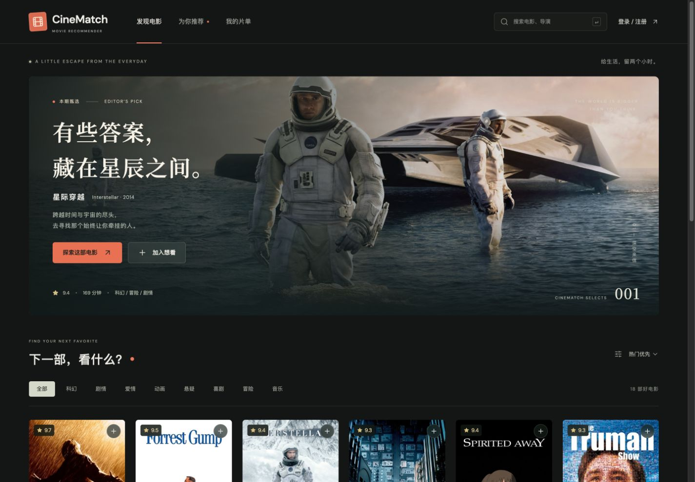
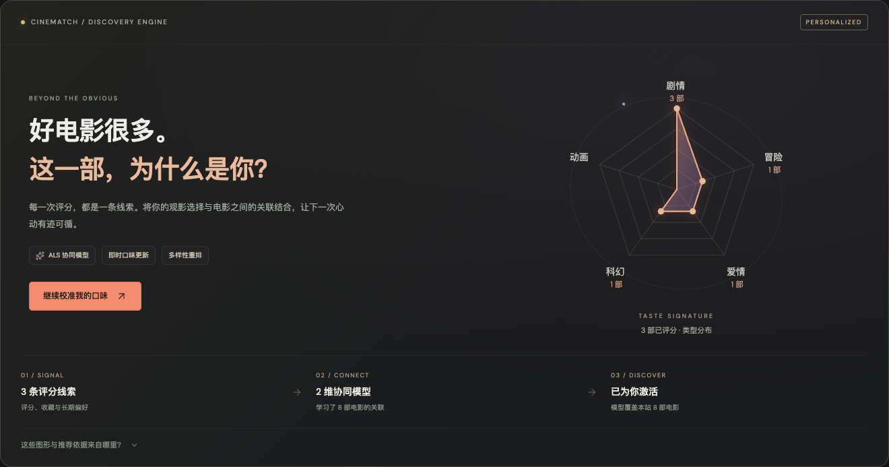
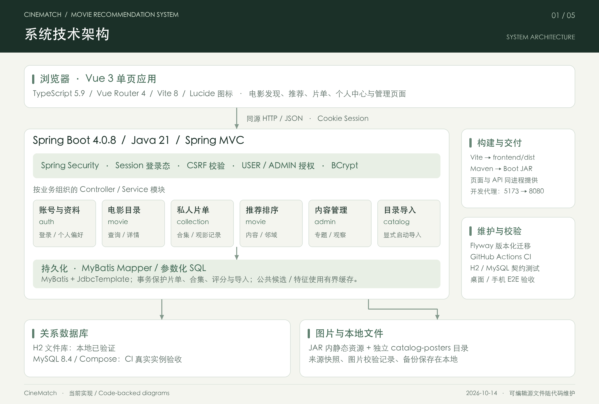
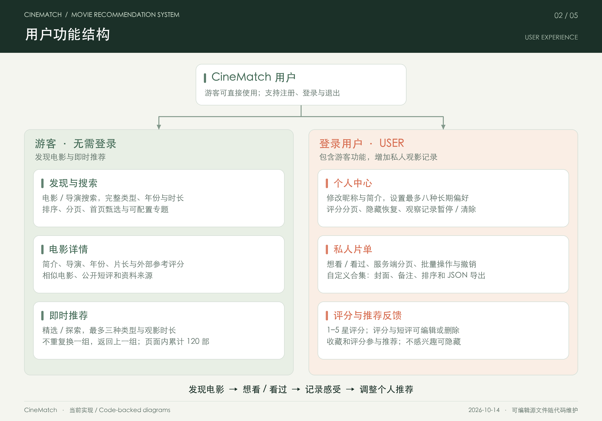
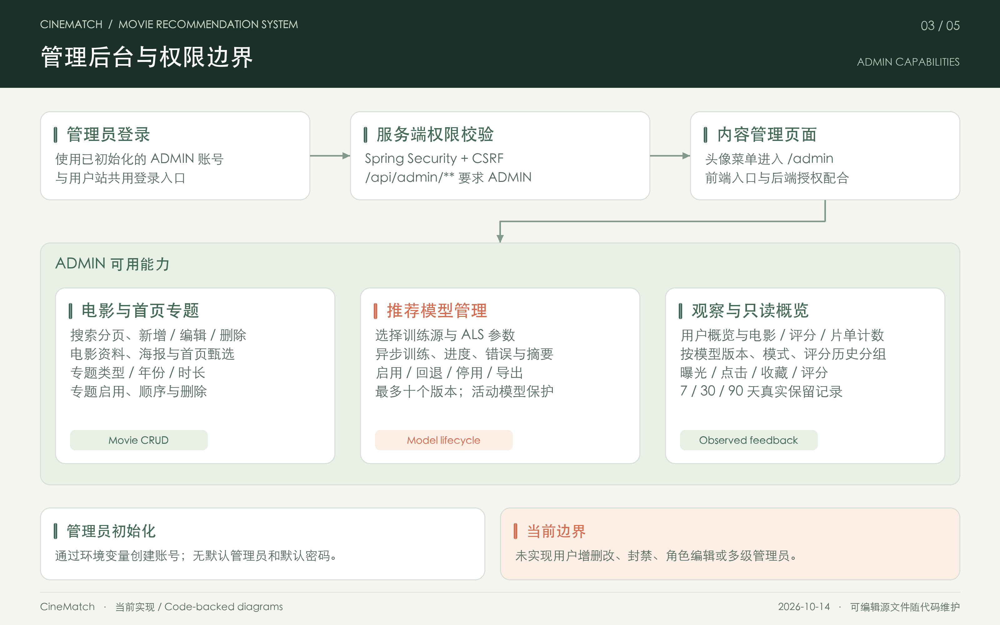
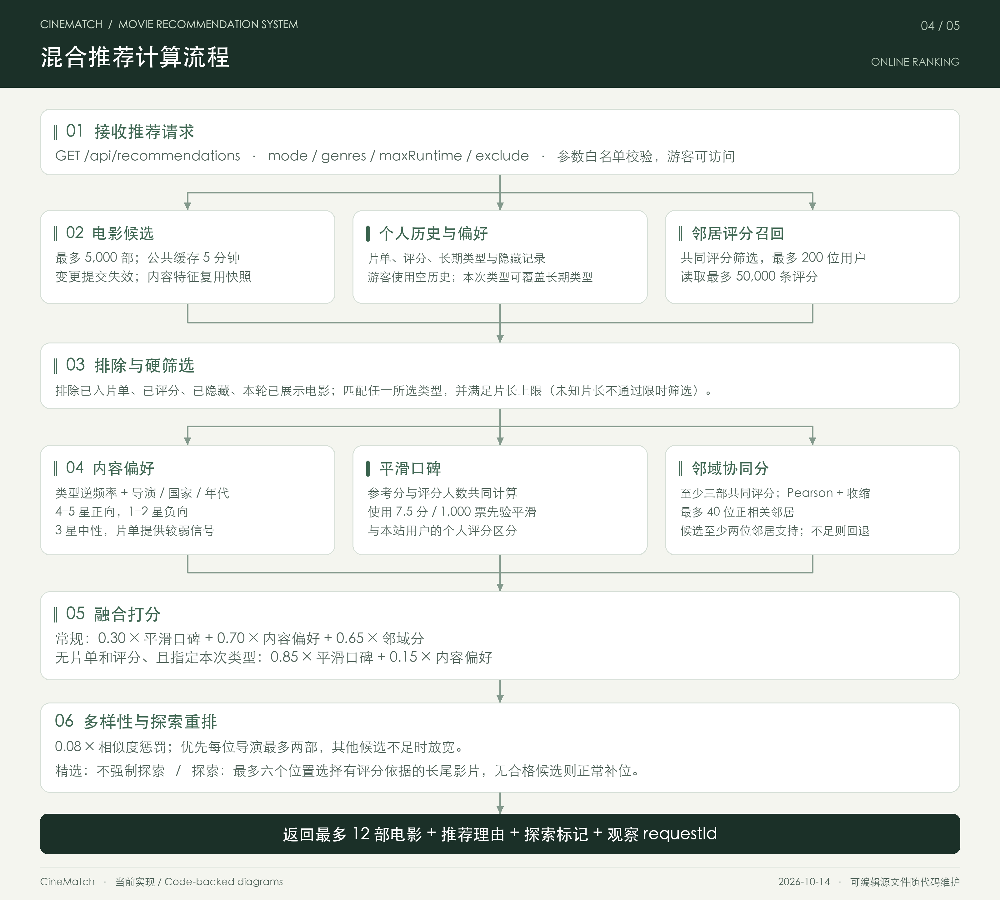

# CineMatch — Movie Recommendation System

**Find your next favorite film.**

CineMatch 是一个可持续维护的个人电影推荐系统，围绕电影发现、私人片单和观影感受设计。新版采用 Vue 3 + TypeScript + Spring Boot 4 + Java 21，用户站与管理后台共用一套 API。



## 文档导航

| 想了解什么 | 文档 |
|---|---|
| 环境准备、开发启动、JAR / MySQL 部署、管理员、备份与升级 | [详细部署与运行指南](docs/deployment.md) |
| 注册、个人中心、片单、推荐与管理后台的操作顺序 | [页面操作与执行步骤](docs/usage.md) |
| 当前算法、信号权重、冷启动、探索模式及评估复现 | [推荐算法与评估指南](docs/recommendation.md) |
| 从克隆代码开始：下载官方评分、生成映射、ALS 训练、启用与备份 | [可训练推荐模型操作指南](docs/recommendation-models.md) |
| 推荐效果、对照实验与局限 | [ALS 与融合推荐评估](docs/recommendation-model-evaluation.md) · [基础混合推荐评估](docs/recommendation-evaluation.md) · [探索模式评估](docs/recommendation-discovery-evaluation.md) · [本站推荐观察与评估口径](docs/recommendation-observation.md) |
| 仓库自带 923 部电影、海报、导入与资料来源 | [电影数据与使用说明](docs/data-sources.md) · [片库文件](data/catalog/movies.json) |
| 模块边界、图表维护与已完成验收 | [架构说明](docs/architecture.md) · [图表维护](docs/diagrams/README.md) · [验收记录](docs/verification.md) |
| 15 分钟答辩、系统与推荐算法展示、逐页讲稿和演示安排 | [答辩材料](docs/defense/README.md) · [可编辑 PPTX](docs/defense/CineMatch-Defense.pptx) · [PDF 预览](docs/defense/CineMatch-Defense.pdf) · [讲稿手册](docs/defense/speaker-guide.md) |

答辩材料按 15 分钟组织，含 18 页正文与 6 页技术附录，覆盖当前系统、ALS-WR 与融合推荐、真实评估和演示步骤。

## 功能

- 发现：电影搜索、完整类型 / 年份 / 时长组合筛选、排序、分页、编辑甄选与可配置专题。
- 详情：电影资料、相似电影、个人评分、短评；独立想看 / 看过按钮，移出可撤销。
- 账号：注册、登录、退出；密码使用 BCrypt；服务端 Session、CSRF 校验、管理员角色控制。
- 个人中心：昵称、简介、偏好类型、观影统计、评分短评分页管理、隐藏推荐恢复、观察记录暂停与清除。
- 片单：想看 / 看过切换、搜索排序、分页、多选批量操作及撤销；移出片单保留独立评分。
- 自定义片单：创建、重命名、介绍、影片封面、逐片备注、上下排序、批量添加及 JSON 导出；按账号隔离。
- 推荐实验室：真实观影指纹、评分引导、模型状态与逐片推荐依据；可训练 ALS-WR 与内容、相似用户评分融合；精选 / 探索模式、临时类型与时长筛选、不重复换一组；支持游客冷启动，排除已收藏、评分及隐藏的影片。
- 管理：电影增删改查、首页甄选、用户概览、首页专题、ALS 训练进度、模型版本启用 / 回退 / 导出，以及按版本 / 模式 / 用户分组的推荐观察。无默认管理员账号。
- 数据：Flyway 数据库迁移；本地 H2 文件库；MySQL 8.4 与 Docker Compose 配套；新增合集、专题、推荐观察与模型版本迁移。

仓库已收录当前本地片库：**923 部电影资料 + 905 张扩充海报**，另复用前端已有的种子图片。`data/catalog/` 约 45 MiB，包含来源和 SHA-256 清单，克隆后无需重新抓取电影数据；用下方 `--catalog` 命令导入。页面区分种子演示分、外部数据集的历史参考分和个人评分；923 部目录的参考分来自 2025 年快照。详见 [电影数据与使用说明](docs/data-sources.md)。

## 推荐实验室



图中为隔离测试账号及小型测试模型；数据来自实际评分与训练状态。当前本机可使用完整 MovieLens 历史评分训练，部署与效果评估见上方独立文档。

## 架构与功能图

以下图示对应当前代码实现。点击图片可打开 SVG 放大查看；PNG、SVG 与 [生成脚本](scripts/generate_architecture.py) 一起保存在仓库中，更新方法及代码对应关系见 [图表维护说明](docs/diagrams/README.md)。数据导入与离线评估图收录于独立算法文档，见下方入口。

### 1. 系统技术架构

Vue 单页应用与 Spring Boot API 组成一个可独立运行的应用，生产构建将页面打入同一 JAR。H2 支持本地持久化，CI 同时验证真实 MySQL 和 Docker Compose 启动、海报挂载及重启后的记录保留，结果见 [验收记录](docs/verification.md)。

[](docs/diagrams/01-system-architecture.svg)

### 2. 用户功能结构

游客可以浏览和按口味获取推荐；登录后可维护个人资料、片单、评分短评与推荐反馈。

[](docs/diagrams/02-user-features.svg)

### 3. 管理后台与权限边界

当前使用 USER / ADMIN 两种角色。管理员可以维护电影和首页专题、查看用户概览、统计与推荐观察，并训练、启用和回退模型；用户概览只读，多级管理员和用户增删改尚未实现。

[](docs/diagrams/03-admin-features.svg)

### 4. 混合推荐计算流程

离线训练 ALS 电影向量，用户最新评分即时求解个人向量；请求时融合内容偏好、平滑口碑与邻域协同评分，再进行多样性重排；最多返回 12 部电影及推荐理由。信号、公式与模式说明见 [推荐算法指南](docs/recommendation.md)。

[](docs/diagrams/04-recommendation-flow.svg)

### 5. 数据与评估图入口

[查看独立文档中的数据导入与离线评估图](docs/recommendation.md#8-评估与复现) · [PNG 图片](docs/diagrams/05-data-and-evaluation.png) · [SVG 矢量图](docs/diagrams/05-data-and-evaluation.svg)。评估方法、结果、局限与复现命令统一放在独立文档中。

## 快速开始

在仓库根目录执行，需要 Node.js 22.12+、Java 21、Maven 3.9+ 和 Python 3.9+：

```sh
bash scripts/dev.sh --catalog
```

首次校验仓库片库、自动安装前端依赖，并事务导入 923 部电影。重复启动按来源匹配更新，保留电影 ID 和个人记录，跳过后台人工编辑的条目。打开 `http://127.0.0.1:5173`，后端监听 `http://127.0.0.1:8080`，按 Ctrl+C 停止。H2 数据默认保存在 `backend/.data/`；普通账号在页面注册，管理员初始化见 [部署指南](docs/deployment.md#5-初始化管理员)。

完整页面与 API 可打包为一个 JAR。停止开发服务后，在仓库根目录执行：

```sh
bash scripts/build.sh
mkdir -p .cache/runtime
release_id="$(date +%Y%m%d-%H%M%S)"
cp backend/target/cinematch-2.0.0-SNAPSHOT.jar ".cache/runtime/cinematch-${release_id}.jar"
cd backend
java -jar "../.cache/runtime/cinematch-${release_id}.jar" \
  --app.catalog.import-file=../data/catalog/movies.json \
  --app.catalog.poster-directory=../data/catalog/posters
```

打开 `http://127.0.0.1:8080`。从 `backend/` 启动以沿用开发数据；每次使用新的运行 JAR 文件名。其他部署方式、海报目录挂载及故障排查见 [详细部署与运行指南](docs/deployment.md)，初次体验可按 [页面操作步骤](docs/usage.md) 执行。

不带 `--catalog` 的开发启动保留轻量模式：空库只有 18 部种子样例。已导入数据会留在数据库中；使用仓库海报时，每次启动仍需配置对应图片目录。JAR 不内嵌扩充数据，部署时同时保留 `data/catalog/`。

Docker / MySQL 使用同一份片库：按 [部署指南](docs/deployment.md#8-docker-compose-与-mysql) 配好 `.env` 后执行 `docker compose -f compose.yml -f compose.catalog.yml up --build -d`。片库不包含账号、个人评分、片单、数据库文件或已训练模型；模型训练与启用按 [模型操作指南](docs/recommendation-models.md) 执行。

## 目录

```text
frontend/        Vue 页面、组件、独立状态模块、样式与桌面 / 手机 E2E
backend/         Spring Boot API、权限、推荐、Flyway 和测试
data/catalog/    923 部电影、905 张海报、来源与文件校验清单
scripts/         开发、构建、片库校验及目录导入工具
docs/            部署操作、架构图、算法评估、数据来源与验收记录
```

本项目是毕业设计 [Movie_Recommend](https://github.com/CodeRayZhang/Movie_Recommend) 的现代化重写，使用独立 Git 历史、数据库及部署配置，原仓库保留。新版可以单独部署和运行，无需启动旧项目及其 Spark、Hadoop 等组件。

新版使用自己的用户账号和观影数据。旧系统中的用户账号、历史评分及观影记录不会自动导入，旧版训练出的 ALS 模型文件也不会直接加载；目前没有提供从旧系统到新版的自动迁移工具。

新版已实现 ALS 模型训练、启用和版本管理。首次部署时，在新版注册账号，并按 [模型训练指南](docs/recommendation-models.md) 准备数据、训练并启用新模型；模型会保存在新版数据库中，正常重启无需重新训练。尚未启用 ALS 时，仍可使用内容、邻域协同与口碑组成的基础混合推荐。

## License

Code is available under the [MIT License](LICENSE). Third-party movie metadata and artwork are not covered by this code license; see [catalog attribution](data/catalog/NOTICE.md) and [artwork sources](docs/artwork.md).
