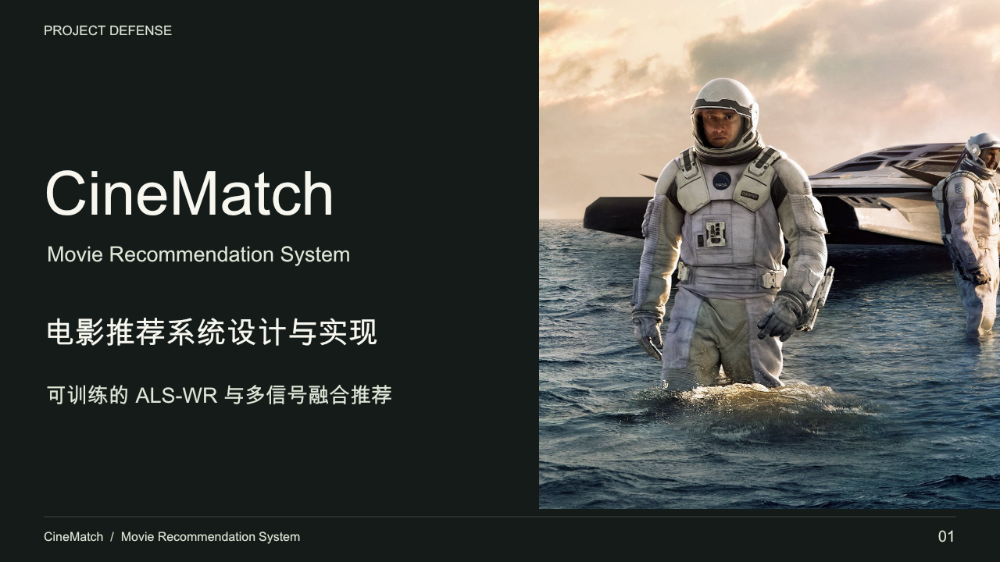

# CineMatch 答辩材料

[返回项目](../../README.md)

面向 **15 分钟答辩**，重点介绍系统实现、ALS-WR 与融合推荐、可复现评估和现场演示。正文 18 页，另附 6 页隐藏附录。原项目与旧 PPT 保持不变。

| 文件 | 用途 |
|---|---|
| [CineMatch-Defense.pptx](CineMatch-Defense.pptx) | 可编辑演示文稿，含逐页讲稿和资料来源 |
| [CineMatch-Defense.pdf](CineMatch-Defense.pdf) | 全部 24 页固定排版预览与备用 |
| [speaker-guide.md](speaker-guide.md) | 时间安排、逐页讲稿、90 秒演示、常见追问 |
| [source/build.mjs](source/build.mjs) | 版式、文字、原生表格、图表、流程图的生成源 |
| [assets/](assets/) | 原始封面素材和真实演示截图 |

## 材料范围

1. 项目背景与重构、角色功能、系统架构和数据链路。
2. 片库发现、私人片单、推荐实验室与模型版本管理。
3. ALS 离线训练、个人向量实时求解、融合评分及回退。
4. 时间切分协议、NDCG / Recall 等指标、热门基线优势和映射边界。
5. 工程验证、现场演示、后续方向。

附录包括 ALS 公式、完整测试指标、逻辑数据关系、部署训练顺序、常见追问及资料入口。演示按 [讲稿手册](speaker-guide.md) 准备。封面个人信息需按实际情况补充。

## 更新方式

日常修改直接使用 PowerPoint、WPS 或 Keynote 打开 PPTX。文字、流程图和表格均可编辑，评估图为原生图表并带内嵌数据工作簿，页面截图保持图片形式。

生成源使用 `@oai/artifact-tool` 与演示文稿运行环境的字体辅助工具，不是网站应用的构建依赖。普通克隆和运行 CineMatch 不需要安装这些演示文稿工具。重新生成需要具备该运行环境，并设置 `PRESENTATIONS_SKILL_DIR`、可解析的 `@oai/artifact-tool` 与可用字体，再运行 `source/build.mjs`。该脚本只输出 `.build/` 草稿和预览，正式发布需执行对应运行环境的结构、字体和原生对象校验，并逐页查看渲染。

更新算法时同步修改第 11、13–15、19–20 页及讲稿，指标以 `docs/recommendation-model-test.json` 为准。更新界面时重新拍摄隔离演示账号截图，避免将真实私人数据纳入材料。

## 来源与边界

内容基于代码 `868059a` 和相应文档，测试记录引用完整验收提交 `c3fb14b`。截图日期为 2026-10-14，来自独立临时 H2 实例、923 部片库、真实完整 MovieLens 1M 训练模型，以及专门建立的演示账号。临时数据库、密码、原始评分和模型权重不包含在本目录。

完整评估在 [独立评估文档](../recommendation-model-evaluation.md)。电影海报与封面图来源及使用范围见 [图片来源](../artwork.md) 和 [片库声明](../../data/catalog/NOTICE.md)。逐页资料出处保存在 PPT 备注中。旧项目链接仅用于说明历史背景，不将其大数据架构作为当前实现。
