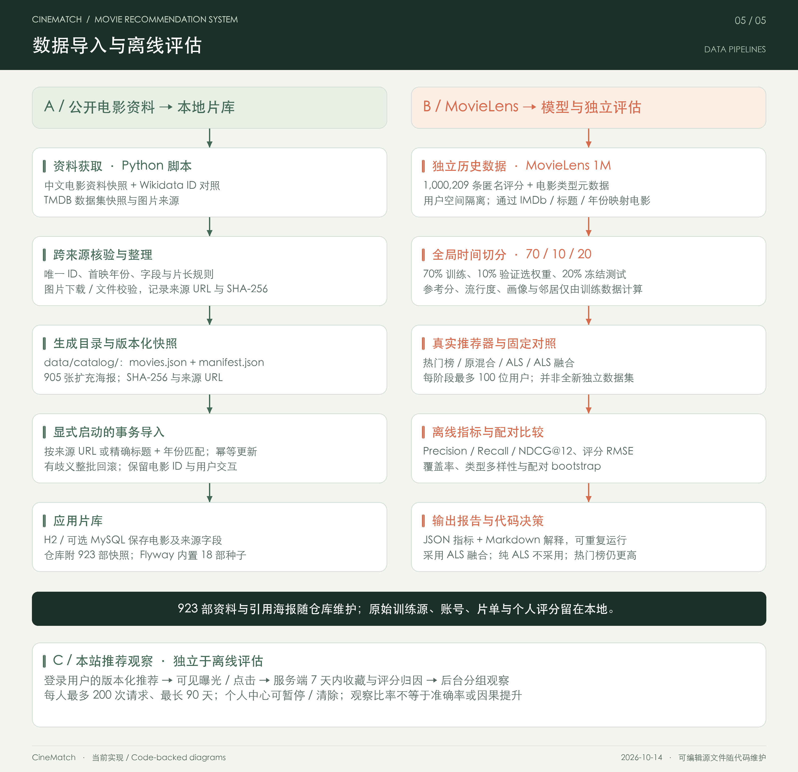

# CineMatch 推荐算法与评估指南

[返回 README](../README.md) · [部署与执行](deployment.md) · [页面操作](usage.md)

版本说明：2026-10-14。当前是 **可训练 ALS-WR + 内容偏好 + 邻域协同 + 平滑口碑**，默认返回最多 12 部电影。活动模型与有效个人评分不足时使用原混合推荐；最新评分会在下一次请求求解个人向量。

[模型数据准备、训练与版本管理](recommendation-models.md) · [本轮独立 ALS / 融合评估](recommendation-model-evaluation.md)。此前的 [基础混合评估](recommendation-evaluation.md) 和 [探索模式评估](recommendation-discovery-evaluation.md) 保留作为历史实验记录，不表示新模型在当前目录的线上效果。

全局模型使用独立线程训练，无需 Spark / Kafka。历史匿名评分保存于私有训练目录，通过经过校验的电影映射参与训练，不写入本站账号与评分表。

## 1. 请求与计算流程

[](diagrams/04-recommendation-flow.svg)

入口是 `GET /api/recommendations`，返回包含 `movie`、`reason`、`exploration`、`engine`、`modelVersion`、`modelApplied` 的数组。查询参数：

| 参数 | 默认值 | 可选值与作用 |
|---|---|---|
| `mode` | `balanced` | `balanced` 为当前默认精选；`explore` 为探索发现 |
| `genres` | 空 | 最多 3 种有效中文类型，逗号分隔，任一匹配即可 |
| `maxRuntime` | `0` | `0 / 90 / 120 / 180`；0 表示不限，其他值排除未知时长和超时长电影 |
| `exclude` | 空 | 最多 120 个正整数电影 ID，用于本页下一组临时排除 |

一次匿名请求示例（程序已启动）：

```sh
curl --fail --silent --show-error --get 'http://127.0.0.1:8080/api/recommendations' \
  --data-urlencode 'mode=explore' \
  --data-urlencode 'genres=科幻,动画' \
  --data-urlencode 'maxRuntime=120'
```

服务端按首页甄选、评分人数降序召回最多 5,000 部电影。排除本人所有想看 / 看过电影、已评分电影、主动隐藏电影及请求临时排除项，再按类型和片长执行硬筛选。片库超过 5,000 部时并非全库召回，小众影片可能在这一阶段就未被取到。

内容特征统计使用“召回电影 + 本人片单或评分涉及的电影”的去重并集，不只使用筛选后的候选。游客没有历史、长期偏好和邻居信号，可以通过本次类型筛选冷启动。

## 2. 内容特征与个人画像

每部电影形成稀疏向量 `v(i)`。类型、导演、国家按逗号、斜杠、顿号或竖线分词、去重；年代按年份除以 10 分组。每部电影的向量最后做 L2 归一化。

| 特征 | 归一化前权重 |
|---|---|
| 类型 g | `1 + 0.35 × ln((N + 1) / (df(g) + 1))` |
| 每位导演 | `0.85` |
| 每个国家 / 地区 | `0.15` |
| 年代 | `0.20` |

`N` 是上述并集电影数，`df(g)` 是包含类型 g 的电影数。低频类型权重较高。当前不分析简介文本，也没有使用文本嵌入或大语言模型。

用户对历史电影的信号权重：

| 行为 | 权重 |
|---|---:|
| 1 星 / 2 星 | −2 / −1 |
| 3 星 | 0 |
| 4 星 / 5 星 | +1 / +2 |
| 想看，尚未评分 | +0.45 |
| 看过，尚未评分 | +0.10 |

存在评分时，以评分权重为准，不再叠加片单状态。分别按权重绝对值累计正向向量 `p` 与负向向量 `n`；主动偏好的每个类型还向 `p` 对应维度增加 1.25。之后分别归一化 `p`、`n`。如果本次传入类型，使用本次类型替代长期类型偏好参与画像；历史评分信号仍保留。

```text
content(u, i) = dot(v(i), p(u)) − 0.80 × dot(v(i), n(u))
```

正向相似提升排序，低星电影的相似特征降低排序。三颗星是中性，但已评分电影仍被排除。“不再推荐”只排除该电影，不会被转换成对整个类型的负偏好；“下一组”也不写永久反馈。

## 3. 邻域协同过滤

数据库先从与本人至少有两部共同评分的账号中，按共同评分数召回最多 200 个邻居，最多读取 50,000 条评分；排序器再执行更严格的筛选：

1. 本人至少有 3 条评分，与该邻居至少有 3 部共同评分。
2. 在共同评分上计算 Pearson 相关；任一方评分无方差时不使用该邻居。
3. 用共同评分数 k 收缩相似度：`s(u,v) = Pearson(u,v) × k/(k+8)`。
4. 只保留 `s > 0.05` 的正相关邻居，取相似度最高的最多 40 位。

对电影 i，按邻居评分相对该邻居平均分的偏差聚合：

```text
neighbor(u, i) = clip(
  Σ[s(u,v) × (rating(v,i) − mean(v))] / (Σs(u,v) + 1.5),
  −1, +1
)
```

求和只包含对 i 有评分的入选邻居；至少两位入选邻居评价过 i 才使用该分支，否则记为 0。`mean(v)` 使用此次召回到的该邻居全部评分计算；Pearson 的均值仅使用共同评分部分。协同分可以为负，邻居评价不等于邻居都喜欢。

没有足够本站用户共同评分时，此分支自然为 0，仍可使用内容与口碑推荐。当前不是把 MovieLens 的历史用户直接当成本站邻居。

## 3.1 ALS-WR 模型与即时个人向量

对已观察到的显式评分最小化平方误差，并分别按每位用户 / 每部电影的评分数缩放 L2 正则项。交替固定电影向量 Y 求用户向量 X，再固定 X 求 Y；使用 Cholesky 求解正定正规方程，无显式求逆。默认 rank=16、iterations=15、regularization=0.1、seed=42。

持久化电影向量、参数与身份映射，不保存外部历史用户的向量。请求时仅取本人映射到当前模型的真实评分，至少 3 部时计算：

```text
x(u) = solve(sum(y(i)y(i)^T) + lambda × n(u) × I, sum(r(u,i)y(i)))
prediction(u,i) = clamp(dot(x(u), y(i)), 0.5, 5)
```

评分编辑或删除会改变下一次 fold-in；不必等待全局重训。用户向量不跨用户缓存。隐藏、片单状态和类型偏好影响融合与排除规则，不被伪造成 ALS 星级标签。无模型、有效评分不足、无映射或电影身份已变化时回到原分支。公式依据见 [Spark 官方 ALS-WR 文档](https://spark.apache.org/docs/4.1.1/ml-collaborative-filtering.html)，当前为独立 Java 实现。

## 4. 平滑口碑与最终相关分

外部参考分 r 为 0–10 分，参考评分人数 c 小于 0 时按 0 处理；固定先验为 7.5 分、1,000 份评分：

```text
quality(i) = ((r × c + 7.5 × 1000) / (c + 1000)) / 10
score(u, i) = 0.30 × quality(i) + 0.70 × content(u,i) + 0.65 × neighbor(u,i)
```

有效个人模型存在且该候选有身份映射时，在上述常规分上叠加：

```text
scoreWithModel(u,i) = score(u,i) + 0.45 × (prediction(u,i) − 3) / 2
```

权重 0.45 由独立验证阶段选定，测试结果与局限见 [模型评估](recommendation-model-evaluation.md)。未映射的候选不增加这一项，仍参与排序。`modelApplied` 表示这部电影实际叠加了模型分，`engine` / `modelVersion` 表示整次请求所用配置。预测星级是模型数值，不显示为匹配百分比。

平滑用于减弱少量高分记录的影响。这里的评分和人数来自电影资料，本站个人星级不会实时改变它们；历史快照人数只是流行度代理。

如果用户**没有任何片单状态、没有评分，同时本次指定了类型**，采用较保守的冷启动公式：

```text
score(u, i) = 0.85 × quality(i) + 0.15 × content(u,i)
```

只有长期偏好、但没有本次类型时，仍走普通公式；完全无历史且无偏好时内容 / 协同分为 0，以口碑为排序基础，再进行下述重排。这些系数是排序权重，不是概率，不能解释为“匹配率”，也不要求相加为 1。

## 5. 多样性与探索发现

逐个挑选最多 12 部：每轮优先考虑每位署名导演在已选结果中少于两部的候选，没有其他可选项时放宽。随后扣除与已选电影最大相似度的惩罚：

```text
adjusted(i) = score(i) − 0.08 × max(dot(v(i), v(j)))
                                      j 为已选电影
```

第一部没有相似度惩罚，分数相同按电影 ID 升序决定。这是 MMR 风格重排；相似度包含完整内容特征，不是仅比较类型。

默认 `balanced` 没有专门的探索配额。`explore` 在第 2、4、6、8、10、12 位尝试从以下候选选择：

- 评分人数低于本次完整召回集合的第 80 百分位阈值，不以类型筛选后的子集重新统计。
- 至少 20 份评分，外部参考分至少 7/10。
- 原始相关分比本轮满足导演约束的最佳候选最多低 0.35。

探索位置还加上最多 0.08 的新颖度奖励：

```text
novelty(i) = 0.08 × (1 − ln(1+c(i)) / ln(1+maxCandidateCount))
```

没有合格探索候选时正常补位，因此不是保证六部小众电影。返回的 `exploration=true` 表示该位置实际执行了探索选择，并不表示所有长尾电影都带该标记。

测试代码保留“第 6、11 位探索、分差 0.18”的双名额实验。它在探索报告 JSON 中名为 `balanced`，**不是当前 API 的 `mode=balanced`**，没有对页面开放。这样保留默认行为，也能复现已做过的实验。

## 6. 推荐解释与交互反馈

对有模型预测且预测 >=3.5 星的电影，优先说明模型评分信号；其余推荐理由按顺序选择：协同分大于 0.15 时说明相似用户信号；否则在正向内容匹配时说明偏好类型或导演；无可用正向理由时使用口碑起点 / 尝试其他故事的文案。解释是对已用信号的简要说明，不是完整因果解释。

评分、片单、偏好和隐藏反馈影响之后的请求。前端换一组把当前已展示 ID 传给 `exclude`，最多累计 120 部；缓存批次保存在页面内存，刷新、切换筛选或观影状态变化后重置。接口不持久化这类临时排除。

详情页“相似电影”是另一条简单路径：按与当前影片的类型交集数量排序，再按参考分排序，最多返回 6 部。它不使用上述个人画像和协同分支，不能套用个性化推荐的评估结果。

原混合观测版本为 `hybrid-v2.1`；个人模型参与时使用 `als-v1:<模型 UUID>`，可在后台区分实际服务版本。登录且启用记录时返回 `requestId`，卡片实际可见后才记曝光，收藏与评分由服务端归因；游客不记录。自定义合集不参与偏好，只有想看 / 看过状态、评分、偏好与隐藏反馈参与。完整指标口径、保留期限与效果判断边界见 [本站推荐观察与评估](recommendation-observation.md)。

## 7. 代码位置与运行成本

| 职责 | 实现 |
|---|---|
| 参数验证、账号信号组装 | [RecommendationController.java](../backend/src/main/java/com/cinematch/movie/RecommendationController.java) |
| 特征、画像、协同、冷启动和重排 | [RecommendationService.java](../backend/src/main/java/com/cinematch/movie/RecommendationService.java) |
| 电影候选、详情和相似电影 | [MovieMapper.java](../backend/src/main/java/com/cinematch/movie/MovieMapper.java)、[MovieController.java](../backend/src/main/java/com/cinematch/movie/MovieController.java) |
| 片单、评分和邻居召回 | [LibraryMapper.java](../backend/src/main/java/com/cinematch/library/LibraryMapper.java) |
| ALS 训练、矩阵求解与个人 fold-in | [AlsModel.java](../backend/src/main/java/com/cinematch/recommender/AlsModel.java) |
| 训练源、快照、版本生命周期 | [TrainingData.java](../backend/src/main/java/com/cinematch/recommender/TrainingData.java)、[ModelRegistry.java](../backend/src/main/java/com/cinematch/recommender/ModelRegistry.java) |
| 真实口味分布与模型状态 | [RecommendationLab.vue](../frontend/src/components/RecommendationLab.vue) |
| 模式、筛选、批次与反馈界面 | [PicksView.vue](../frontend/src/views/PicksView.vue) |
| 排序规则回归 | [RecommendationTest.java](../backend/src/test/java/com/cinematch/RecommendationTest.java) |
| 数据切分、对照与指标输出 | [RecommendationEvaluationTest.java](../backend/src/test/java/com/cinematch/RecommendationEvaluationTest.java) |

当前公共电影候选使用进程内 5 分钟缓存，后台电影变更及目录导入事务提交后主动失效。内容特征缓存一个按电影列表内容匹配的不可变快照；包含召回上限外的本人历史时会重建 / 替换，因此跨用户命中率受历史差异影响。个人偏好、邻居评分与推荐结果仍每次计算，不跨用户缓存。ALS 活动模型的电影向量按版本缓存在进程内，版本切换后重载；每次重新求解个人向量。无需向量数据库或独立训练服务。5,000 个候选、200 个邻居召回、50,000 条评分及 40 个参与计算的邻居是规模边界，不等于已完成该规模的生产并发压测。

## 8. 评估与复现

[](diagrams/05-data-and-evaluation.svg)

图中左侧公开目录服务应用，右侧 MovieLens 用于隔离训练与时间切分评估，下方为本站行为观察；训练时通过严格电影映射连接两个电影 ID 空间，外部用户不导入本站。图中的 923 部电影资料与引用海报现已随仓库保存，用 `bash scripts/dev.sh --catalog` 导入；不带该参数的空库仍只有 18 部种子样例。历史训练评分和已训练模型需按独立指南自行准备。图表源文件与维护方法见 [图表说明](diagrams/README.md)。

### 8.1 已有报告与结论

| 报告 | 回答的问题 | 结论与完整数据 |
|---|---|---|
| [ALS 模型与融合评估](recommendation-model-evaluation.md) | 可训练模型能否改善原混合排序？ | 训练、验证和测试分离；有收益也有覆盖率代价，热门基线仍更高。 |
| [基础混合推荐评估](recommendation-evaluation.md) | 类型累加、内容分支、完整混合算法如何比较？ | 同一批 100 位用户，NDCG@12 从 0.0641 到 0.2239；但片库覆盖率从 7.21% 降至 5.49%。[JSON](recommendation-evaluation.json) |
| [探索模式评估与上线决策](recommendation-discovery-evaluation.md) | 增加小众曝光的代价是什么？ | 另一批 100 位用户，默认 / 探索 NDCG@12 为 0.2283 / 0.1720，长尾曝光为 10.83% / 50.75%；保留默认精选，探索由用户选择。[JSON](recommendation-discovery-evaluation.json) |

两轮用户不重叠，不将第二轮指标与第一轮直接计算提升。双探索名额也降低了留出排序指标，因此没有作为默认上线；增加长尾曝光不能称为“准确率全面提升”。

### 8.2 数据切分与指标含义

MovieLens 1M 的 1,000,209 条评分按全局时间切分：训练 800,168 条、测试 200,041 条，分界时间戳 `975768738`，同秒记录全部留在训练。候选为训练中出现的 3,662 部电影，排除本人训练期已评分电影；参考分、人数、画像和邻居仅来自训练记录。每位测试用户至少有 20 条训练评分和 5 部未来高分候选，测试期 4–5 星视为相关项。

第一轮从 843 位符合条件用户中以种子 `20261013` 抽取 100 位；第二轮先排除这 100 位，再从剩余 743 位以种子 `20261014` 抽取 100 位。每个实验内部在同一组用户、相同完整候选与排除规则上比较，不是仅对少量抽样负例排序。

| 指标 | 含义 |
|---|---|
| Precision@12 | 每份前 12 部推荐中，未来高分电影的比例，再对用户取平均 |
| Recall@12 | 找回的未来高分电影占该用户相关候选的比例，再对用户取平均 |
| NDCG@12 | 按排名折扣的命中得分，除以该用户理想排序得分，越接近 1 越好 |
| Hit Rate@12 | 至少命中一部未来高分电影的用户比例，不是每部电影的准确率 |
| 片库覆盖率 | 全部推荐出现的不同电影数 / 训练片库电影数 |
| 类型多样性 | 每份推荐中电影两两类型集合的平均 Jaccard 距离，再对用户取平均 |
| 长尾曝光 | 推荐位置中，评分人数低于训练片库第 80 百分位阈值的电影比例 |

报告还给出用户配对 bootstrap 的 NDCG 差值 95% 区间（2,000 次重采样、种子 42），记录匿名样本 ID、原文件 SHA-256 和运行耗时。耗时仅包含本机进程内排序，不含数据库 / 网络；固定执行顺序存在 JVM 预热影响，不能用于宣布探索模式更快或推算并发吞吐。

### 8.3 如何重新运行

准备已取得使用许可的 MovieLens 1M 本地目录，包含 `movies.dat` 和 `ratings.dat`；不需要 `users.dat`。支持官方 `::` 分隔格式和旧项目转换的逗号格式，电影标题按 ISO-8859-1 读取。原数据不随本仓库分发，使用官方文件与转换副本时 SHA-256 不同，比较时需保留实际数据来源。

在仓库根目录，先运行不需要 MovieLens 的规则与接口回归：

```sh
bash scripts/mvn.sh -Dtest=RecommendationTest,ApiIntegrationTest test
```

复现第一轮冻结基线与混合算法对照（替换真实绝对数据路径）：

```sh
bash scripts/mvn.sh -Dtest=RecommendationEvaluationTest \
  -Drecommendation.evaluation.data=/absolute/path/to/ml-1m test
```

输出 `backend/target/recommendation-evaluation.json`。第一轮使用测试目录冻结的 `BaselineRecommender` 与 `PreviousHybridRecommender`，不把后来的探索逻辑悄悄混入旧报告。

运行探索实验：

```sh
bash scripts/mvn.sh -Dtest=RecommendationEvaluationTest \
  -Drecommendation.evaluation.data=/absolute/path/to/ml-1m \
  -Drecommendation.evaluation.discovery=true test
```

输出 `backend/target/recommendation-discovery-evaluation.json`，对照为冻结版，实验分支调用当前排序器。未提供数据路径时这个大型测试自动跳过；“普通测试通过”不能解释为本轮已重新执行真实数据评估。评估不连接应用数据库，不读私人账号，不写电影、片单或评分。

更新算法时先保留旧报告，再记录新的代码版本、数据摘要、参数、样本种子和结果。确认 JSON 与结论一致后，人工更新独立 Markdown 报告；不要只覆盖数值或把不同样本的结果拼成一次实验。若反复根据同一留出集调参，应增加新的验证 / 测试划分，避免将已参与选择的样本当成全新证据。

## 9. 当前局限与后续验证方向

- MovieLens 较早，评估样本是有充分历史且测试期继续活跃的用户，不能等同于当前中文片库的线上满意度。
- 评估数据缺少导演、国家和本站主动偏好；导演限制、隐藏反馈与冷启动修正由规则测试和实际片库操作覆盖，现有离线指标不能证明这些信号的效果。
- 所有评估用户都有历史评分，因此新用户的 `0.85 / 0.15` 冷启动权重没有通过这批用户直接验证。
- 个人项目共同评分稀少时，协同贡献有限；积累本站真实交互后，应单独观察新用户、稀疏用户和活跃用户。
- 默认排序仍有跨用户结果集中问题。探索增加长尾曝光和覆盖率，但本轮类型多样性下降，应分别看各项指标。
- 已实现公共候选与内容特征缓存；扩大规模时仍需实测召回覆盖、数据库查询与并发延迟，再决定是否引入离线邻居 / 特征预计算。
